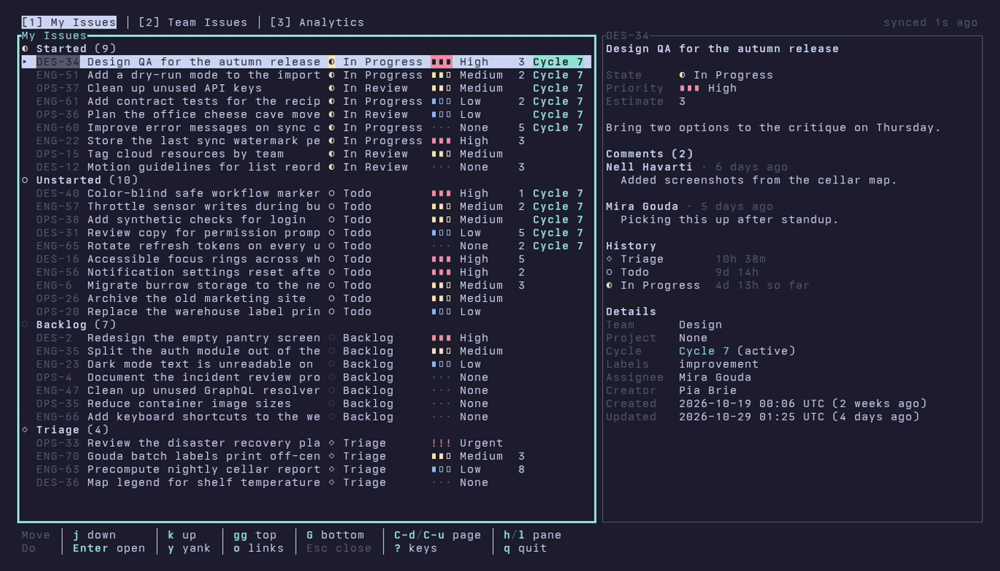

```
$$\                       $$\
$$ |                      $$ |
$$ | $$$$$$\   $$$$$$\  $$$$$$\
$$ |$$  __$$\  \____$$\ \_$$  _|
$$ |$$ |  \__| $$$$$$$ |  $$ |
$$ |$$ |      $$  __$$ |  $$ |$$\
$$ |$$ |      \$$$$$$$ |  \$$$$  |
\__|\__|       \_______|   \____/
```

A fast, keyboard-first terminal client for [Linear](https://linear.app).

[](https://crates.io/crates/linear-rat)
[](https://github.com/cxrlos/linear-rat/actions/workflows/ci.yml)



I wanted to triage and move my Linear issues without leaving the terminal, so I wrote lrat. The crate is `linear-rat`; the binary is `lrat`. It runs on Linux and macOS.

## Install

Pick one. Each puts `lrat` on your `PATH`.

```bash
# From source, with Rust 1.88 or newer
cargo install --locked linear-rat

# A prebuilt binary, through cargo-binstall
cargo binstall linear-rat

# Homebrew
brew install cxrlos/tap/linear-rat

# The shell installer from the latest GitHub release (installs into ~/.cargo/bin)
curl --proto '=https' --tlsv1.2 -LsSf \
  https://github.com/cxrlos/linear-rat/releases/latest/download/linear-rat-installer.sh \
  | sh
```

Prebuilt binaries cover `x86_64` and `aarch64` on Linux (glibc) and macOS. Every [GitHub release](https://github.com/cxrlos/linear-rat/releases) carries the archives and their checksums if you prefer to install by hand.

## Quick start

Try it first with made-up data. This needs no Linear account and makes no network requests:

```bash
lrat --demo
```

Then give lrat a [Linear personal API key](https://linear.app/settings/account/security). It checks the key with Linear and keeps it in your OS keyring:

```bash
lrat auth login                  # prompts for the key
lrat auth login --from-keyring   # or reads a keyring entry you already have
lrat
```

`lrat auth status` shows which key is in use, and `LINEAR_API_KEY` overrides the keyring when it is set. [docs/auth.md](https://github.com/cxrlos/linear-rat/blob/main/docs/auth.md) covers every way to log in.

Press `?` anywhere to see the keys for the screen you are on.

## What it does

- **My Issues**: your open issues, grouped by workflow state. From 120 columns on (you can change that), the focused issue's detail sits beside the list: its description rendered from Markdown, comments, state history and fields.
- **Edits without waiting**: change the workflow state, assignee, priority, labels or estimate from a filterable picker. The change shows at once and rolls back with a notice if Linear refuses it. Write comments in `$EDITOR`, and create issues with `n`.
- **The palette** (`:` or `Ctrl-k`) finds any action or loaded issue by fuzzy match, and `/` searches every issue in the workspace.
- **Team Issues**: a team's issues, filtered by workflow state, assignee, label, cycle or project.
- **Analytics**: throughput, net flow, cycle time and lead time, issue age and completion by project, label and priority, for you or for a team, over 4, 12 or 26 weeks. The per-person breakdown is shown only to team owners.
- **Copy and open**: copy an issue's identifier, URL, branch name or a Markdown link, and open the issue or its pull requests in the browser.
- **Stays current**: lrat polls Linear for changes, can take live updates from Linear's websocket, and shows the last session's snapshot while it loads, which stays on screen when Linear cannot be reached.
- **Yours to configure**: every key can be rebound, and there are ten Base16 themes built in, or bring your own.

## Docs

- [Keymap](https://github.com/cxrlos/linear-rat/blob/main/docs/keymap.md): every action with its default keys, generated from the code.
- [Configuration](https://github.com/cxrlos/linear-rat/blob/main/docs/config.md): `config.toml`, keys, themes, sync and analytics settings.
- [Logging in](https://github.com/cxrlos/linear-rat/blob/main/docs/auth.md): API keys and the OS keyring.

## Contributing and security

Contributions are welcome; [CONTRIBUTING.md](https://github.com/cxrlos/linear-rat/blob/main/CONTRIBUTING.md) explains the workflow. Please report vulnerabilities privately as described in [SECURITY.md](https://github.com/cxrlos/linear-rat/blob/main/SECURITY.md), not in a public issue.

## License

Licensed under either of [Apache License, Version 2.0](https://github.com/cxrlos/linear-rat/blob/main/LICENSE-APACHE) or [MIT license](https://github.com/cxrlos/linear-rat/blob/main/LICENSE-MIT), at your option.
