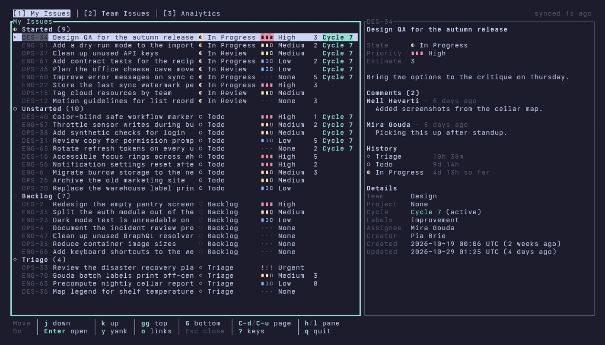

```
$$\                       $$\
$$ |                      $$ |
$$ | $$$$$$\   $$$$$$\  $$$$$$\
$$ |$$  __$$\  \____$$\ \_$$  _|
$$ |$$ |  \__| $$$$$$$ |  $$ |
$$ |$$ |      $$  __$$ |  $$ |$$\
$$ |$$ |      \$$$$$$$ |  \$$$$  |
\__|\__|       \_______|   \____/
```

A fast, keyboard-first terminal client for [Linear](https://linear.app).

[](https://crates.io/crates/linear-rat)
[](https://github.com/cxrlos/linear-rat/actions/workflows/ci.yml)



I wanted to triage and move my Linear issues without leaving the terminal, so I wrote lrat. The crate is `linear-rat`; the binary is `lrat`. It runs on Linux and macOS.

## Install

Pick one. Each puts `lrat` on your `PATH`.

```bash
# From source, with Rust 1.88 or newer
cargo install --locked linear-rat

# A prebuilt binary, through cargo-binstall
cargo binstall linear-rat

# Homebrew
brew install cxrlos/tap/linear-rat

# The shell installer from the latest GitHub release (installs into ~/.cargo/bin)
curl --proto '=https' --tlsv1.2 -LsSf \
  https://github.com/cxrlos/linear-rat/releases/latest/download/linear-rat-installer.sh \
  | sh
```

Prebuilt binaries cover `x86_64` and `aarch64` on Linux (glibc) and macOS. Every [GitHub release](https://github.com/cxrlos/linear-rat/releases) carries the archives and their checksums if you prefer to install by hand.

Once a day lrat asks GitHub whether a newer release is out (`GET https://api.github.com/repos/cxrlos/linear-rat/releases/latest`, with lrat's version as the User-Agent and nothing else: no API key and no workspace data), and if so shows a muted notice on the tab row. Besides uploading a file you chose to attach, to the upload URL Linear signs for it (with only the headers Linear returns, never the API key), it is the only request lrat makes to anything other than Linear. Turn it off with `check = false` under `[updates]` in `config.toml`, or by setting `LRAT_NO_UPDATE_CHECK=1`. Installs from the AUR or Nix never show the notice.

`lrat completions bash|zsh|fish` prints a completion script for your shell, for example `lrat completions zsh > ~/.zfunc/_lrat`. Each release archive also carries the scripts under `completions/` and the man pages under `man/`.

## Quick start

Try it first with made-up data. This needs no Linear account and makes no network requests:

```bash
lrat --demo
```

Then give lrat a [Linear personal API key](https://linear.app/settings/account/security). It checks the key with Linear and keeps it in your OS keyring:

```bash
lrat auth login                  # prompts for the key
lrat auth login --from-keyring   # or reads a keyring entry you already have
lrat
```

`lrat auth status` shows which key is in use, and `LINEAR_API_KEY` overrides the keyring when it is set. [docs/auth.md](https://github.com/cxrlos/linear-rat/blob/main/docs/auth.md) covers every way to log in.

Press `?` anywhere to see the keys for the screen you are on.

## What it does

- **My Issues**: your open issues, grouped by workflow state unless you group or sort them another way with `vg` and `vs`. From 120 columns on (you can change that), the focused issue's detail sits beside the list: its description rendered from Markdown, parent, sub-issues and relations, comments, state history, attachments and fields. A row whose issue an open issue blocks carries `▲`.
- **Edits without waiting**: change the workflow state, assignee, priority, labels, estimate, cycle, project, project milestone or parent from a filterable picker, add or remove relations, and type a due date as `2026-12-24`, `+3d`, `fri` or `clear`. Archive (`A`) and unarchive (`U`) an issue (an archived issue leaves My Issues and Team Issues and stays in search results, where its detail says it is archived and `U` brings it back), subscribe to it or unsubscribe (`S`), and move it to Linear's trash (`X`, after a confirmation; it stays restorable in Linear for 30 days, and lrat never deletes for good). The change shows at once and rolls back with a notice if Linear refuses it. Write comments in `$EDITOR`, and create issues with `n`. Attach a local file (`F`, up to 50 MB, Tab completes the path) or a link (`W`) to the focused issue.
- **The palette** (`:` or `Ctrl-k`) finds any action or loaded issue by fuzzy match, and `/` searches every issue in the workspace, its comments too if you ask, or from Team Issues only the team and filter on screen.
- **Team Issues**: a team's issues, filtered by workflow state, assignee, label, cycle or project, or to the issues another issue blocks, and grouped and sorted like My Issues.
- **Cycles and Projects**: a team's active, next and recent cycles with how many of their issues are done, and your teams' projects with their status, target date, lead and progress. Enter lists a cycle's issues, or a project's grouped by project milestone, with every issue action and the same grouping and sorting.
- **Inbox** (`6`): your issue notifications grouped by issue, newest first, with the unread count on its tab. Mark one read or unread (`m`) or its whole issue read (`M`), archive it (`A`), snooze it until in an hour, tomorrow or next Monday (`z`), or open its issue with the comment it is about focused (`Enter`). Archive all read runs from the palette.
- **Analytics**: throughput, net flow, cycle time and lead time, issue age and completion by project, label and priority, for you or for a team, over 4, 12 or 26 weeks. The per-person breakdown is shown only to team owners.
- **Copy and open**: copy an issue's identifier, URL, branch name or a Markdown link, open the issue, its pull requests or any link in it in the browser, or copy a link's URL from the link pickers.
- **Stays current**: lrat polls Linear for changes, can take live updates from Linear's websocket, and shows the last session's snapshot while it loads, which stays on screen when Linear cannot be reached.
- **Errors you can act on**: a failure shows once as a notice and stays in a log of the last 100 (`!`, or `:messages` in the palette), each with when it happened, what lrat was doing, what kind of failure it was and a suggested fix. Once Linear refuses a kind of write for your API key in a team, lrat mutes those actions there with the reason and says why instead of trying again, for 15 minutes or until you press `r`, and a team the key cannot reach says so on Team Issues.
- **Yours to configure**: every key can be rebound, and there are ten Base16 themes built in, or bring your own.

## Docs

- [Keymap](https://github.com/cxrlos/linear-rat/blob/main/docs/keymap.md): every action with its default keys, generated from the code.
- [Configuration](https://github.com/cxrlos/linear-rat/blob/main/docs/config.md): `config.toml`, keys, themes, sync, analytics and release check settings.
- [Logging in](https://github.com/cxrlos/linear-rat/blob/main/docs/auth.md): API keys and the OS keyring.

## Contributing and security

Contributions are welcome; [CONTRIBUTING.md](https://github.com/cxrlos/linear-rat/blob/main/CONTRIBUTING.md) explains the workflow. Please report vulnerabilities privately as described in [SECURITY.md](https://github.com/cxrlos/linear-rat/blob/main/SECURITY.md), not in a public issue.

## License

Licensed under either of [Apache License, Version 2.0](https://github.com/cxrlos/linear-rat/blob/main/LICENSE-APACHE) or [MIT license](https://github.com/cxrlos/linear-rat/blob/main/LICENSE-MIT), at your option.
